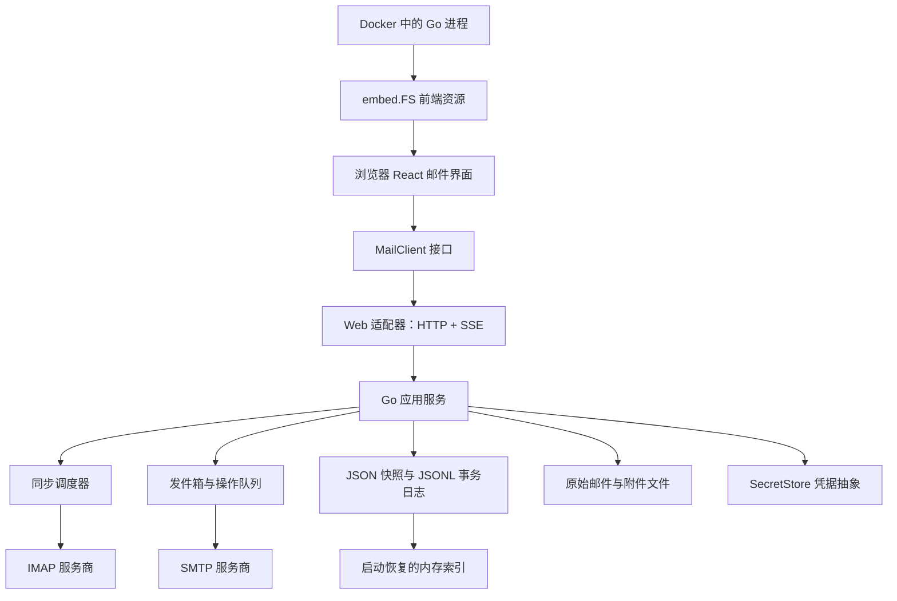

# nekoport 邮件客户端设计方案

> 设计日期：2026-11-23。状态：已按后续授权完成首期实现；本文保留架构与后续演进设计，实际功能、取舍和验证边界见 `docs/implementation-status.md`。
>
> 仓库落地：`https://github.com/a1zaza/nekoport`，Go module 为 `github.com/a1zaza/nekoport`，GHCR 目标为 `ghcr.io/a1zaza/nekoport:latest`。下文中“仓库未指定”的设计前提已由此取代；包可见性与发布状态仍以实际发布结果为准。

> 用户约束：Go 后端 + React 前端；页面风格参考 `../v2way`；面向个人使用，以 Docker 单服务部署、Go 可执行文件内嵌 React 发布资源；邮箱由用户手动配置，不接入默认邮件商；仅支持富文本阅读和纯文本编辑；暂不考虑桌面端与远程托管方案；不使用 SQLite 或其他嵌入式数据库，结构化状态以 JSON / JSONL 持久化，每次启动将必要索引加载到内存。设计阶段之后已获得实施授权；仍不自动执行 Git 操作、Docker 构建/启动或远程发布。

## 1. 产品定位与边界

面向个人使用，提供多邮箱聚合、收发邮件、服务端缓存与统一搜索。暂用名称 `nekoport`，默认中文界面。交付形态固定为 Docker 单服务，通过浏览器访问。

按“单用户、多邮箱、单实例”设计。容器中运行一个 Go 进程，同时提供内嵌前端、HTTP API、同步与后台任务；用户浏览器同源访问该服务。配置、邮件状态与内容写入挂载的数据目录，镜像与用户数据分离。当前不设计远程托管、多用户服务和桌面应用。

这是连接既有邮箱服务的客户端，不承担邮件服务器、域名 MX、反垃圾网关或邮件投递基础设施职责。首期不包含组织多租户、POP3、Exchange 专用协议、日历、PGP/S/MIME、AI 摘要和自动分类。

| 阶段 | 功能范围 |
| --- | --- |
| 首期核心 | 手动添加 IMAP/SMTP 邮箱、多账号导航、文件夹、收件列表、阅读、纯文本写信/回复/转发、附件、草稿、发件箱、已读/星标、移动/删除、缓存邮件搜索、同步状态与错误恢复 |
| 后续增强 | 可靠会话聚合、纯文本签名、联系人补全、规则、远端搜索、完整备份恢复；不包含富文本编辑和桌面打包 |
| 最终交付 | Go 内嵌前端的单服务 Docker 镜像，以及个人使用的 Compose 配置与数据维护说明 |

不预置邮箱账号、默认邮件商、服务商选择向导或按邮箱域名自动发现配置。用户自行填写 IMAP/SMTP 主机、端口、TLS 模式、登录用户名和密码/应用密码；接收与发送允许使用不同用户名与凭据。端口可提供通用协议建议值，但不得据此自动填充邮件商地址。当前不实现专用服务商 API、OAuth 应用注册或授权回调；仅支持 OAuth 的邮箱暂不兼容，在连接错误中明确说明。

## 2. 视觉语言与参考依据

已只读检查 `../v2way/web/src/style.css`、`web/src/main.tsx` 以及项目界面约定。借鉴视觉规范，邮件页面按阅读任务重新布局，不复制其网关业务或账号配置。

| 项目 | 设计值 / 用法 |
| --- | --- |
| 应用背景 | `#181818` |
| 面板背景 | `#202020`，输入背景 `#292929` |
| 分隔线 | `#323232`，输入边框 `#454545` |
| 主色 | `#007acc`，链接与信息提示 `#70b6e7` |
| 文字 | 主文字 `#d4d4d4`，次级文字 `#85858b` |
| 状态色 | 成功 `#89c695`，错误 `#ef9892`；同时提供图标和中文文案 |
| 字体 | 应用 UI 使用 `Consolas, 'LXGW WenKai', monospace`；长邮件正文使用中文系统无衬线字体提高阅读效率 |
| 尺寸 | 控件圆角 4px，宽屏按钮至少 34px，触屏交互目标至少 44px |
| 密度 | UI 正文 13px；阅读正文默认 15px、行高 1.7，可调整 |
| 交互 | 左侧导航直角蓝色选中条；文字操作使用带背景/边框按钮，图标按钮有名称与提示 |

不默认使用渐变、大面积阴影、营销式大标题或装饰卡片。账号设置等表单可沿用参考项目居中内容区、最大宽度 1600px；邮件工作区填满可用宽度，各栏独立滚动。

登录页根据后续界面反馈，明确采用 v2way 的满屏左右等分结构：左侧为带淡蓝暗色背景的品牌介绍区，品牌位于顶部、介绍居中、说明置底；右侧为最大宽度 340px 的无外层卡片表单，包含登录标题、输入、全宽主按钮和底部分隔说明。720px 及以下隐藏左侧介绍与底部说明，保留紧凑品牌栏，表单顶部对齐、最大宽度 420px，触屏输入和按钮至少 44px；短屏通过页面滚动保证操作可达。

字体文件现已按用户后续指示与 v2way 原样对齐，通过本地 `@font-face` 加载，不依赖用户安装字体或联网字体服务。中文文件实际为霞鹜臻楷，沿用参考项目 CSS 家族别名 `LXGW WenKai`；字体来源、哈希与授权说明见 `web/src/assets/fonts/README.md` 和 `web/public/licenses/`。

## 3. 信息架构与页面布局

### 3.1 宽屏浏览器主界面

采用顶栏与三栏工作区。1440px 宽参考分配：左侧导航约 224px、列表约 360px、阅读区占剩余宽度。列表与阅读区之间可拖拽调整，宽度设置本地保存；最小宽度触发两栏模式。

```text
┌──────────────────────────────────────────────────────────────────┐
│ nekoport      [ 搜索当前邮箱中的邮件…         ]   同步状态   设置 │
├──────────────┬───────────────────────┬────────────────────────────┤
│ ＋ 写邮件    │ 收件箱          刷新  │ 回复  全部回复  转发  更多 │
│              │ 全部 / 未读 / 有附件  ├────────────────────────────┤
│ 所有收件箱 8 ├───────────────────────┤ 会议安排                   │
│ 星标邮件     │ ● 张三          10:24 │ 张三 <示例地址>            │
│ 草稿       2 │   会议安排            │ 收件人、时间、邮件详情     │
│ 发件箱     1 │   请确认明天的时间…   ├────────────────────────────┤
│              ├───────────────────────┤                            │
│ 工作邮箱   ▾ │   李四          昨天  │ 邮件正文                   │
│   收件箱   5 │   项目资料       ☆ 📎 │                            │
│   已发送     │   附件已整理…         │                            │
│   垃圾邮件   │                       │ 附件名称 / 大小 / 下载     │
│   已删除     │                       │                            │
│ ＋ 添加邮箱 │                       │                            │
└──────────────┴───────────────────────┴────────────────────────────┘
```

- **顶栏**：全局搜索、当前同步状态、设置入口。搜索框显示实际作用域，可切换当前文件夹、当前账号或所有账号。
- **导航栏**：聚合收件箱、星标、本地草稿、发件箱；各账号展开服务器文件夹，未读数字来自同步数据。首期不承诺服务商标签的完整语义。
- **邮件列表**：默认每封邮件一行块，显示发件人、主题、摘要、时间、未读点、星标和附件。选中、未读、键盘焦点分别有独立表现。多选后出现批量操作工具栏。
- **阅读区**：顶部固定操作栏；主题、收发件人、时间、展开详情；正文与附件。空选中显示“选择一封邮件开始阅读”。
- **会话聚合**：首期使用单封邮件模型；后续按 References / In-Reply-To 建立会话，主题仅作辅助，避免同主题误合并。

### 3.2 其他页面

| 页面 | 内容与行为 |
| --- | --- |
| 首次使用 | 登录个人应用 → 手动填写邮箱协议配置 → 分别测试接收和发送连接 → 选择同步范围；应用访问凭据通过初始化流程建立 |
| 添加/编辑邮箱 | 邮箱地址、显示名、IMAP/SMTP 地址与端口、TLS 模式、各自登录用户名与密码/应用密码；不预选邮件商，接收与发送分别验证，不暗中发送测试邮件 |
| 写邮件 | 账号/发件身份、收件人、抄送/密送、主题、纯文本正文、附件、保存状态、发送按钮；默认右侧大抽屉，可最大化，无富文本工具栏 |
| 账号设置 | 账号卡片、最近成功同步时间、错误摘要、连接检查、暂停同步、移除账号 |
| 应用设置 | 阅读字号、远程图片策略、缓存范围与配额、快捷键说明、会话管理 |
| 同步详情 | 账号与文件夹进度、当前阶段、重试时间；可复制脱敏诊断摘要 |
| 发件箱 | 待发送、发送中、失败、结果待确认；“重试”仅对确定未发送的任务开放 |

### 3.3 关键交互

- 发送前检查收件地址、空主题与未完成附件；空主题确认使用应用弹窗。发送动作必须显式触发，快捷键使用 Ctrl/Cmd + Enter 并提供确认偏好。
- 草稿短暂防抖保存，通过版本号检测并发编辑；显示“正在保存 / 已保存 / 保存失败”，关闭前等待保存或提示保留编辑。
- 首期草稿为应用侧本地草稿，跨浏览器访问同一实例可见；不承诺自动与其他邮箱客户端草稿互通。远端草稿 APPEND 与旧版本清理留待后续。
- 收到 HTML/富文本邮件时提供安全渲染与“查看纯文本”切换；缺少 text/plain 时从净化后的 HTML 提取文本。编辑区只接受纯文本粘贴，不保留 HTML 样式、内嵌脚本或富文本签名；无附件发送 text/plain，有附件使用 multipart/mixed 包含纯文本正文，不生成富文本替代部分。以附件方式转发的原始 .eml 保留原内容，但不进入可编辑正文。
- 删除默认移动到服务器已删除文件夹；缺少该文件夹时说明替代行为，永久删除必须确认。清空文件夹明确数量与影响账号。
- 断网或服务商不可达时仍允许查看已缓存内容、编辑草稿；发送进入待发送队列。Web 浏览器只有在可连接 Go 服务时才具有上述能力，首期不做 PWA 完全离线。
- 阅读成功后更新已读状态，支持关闭自动标已读；写操作本地显示待同步状态，失败可恢复，不悄悄丢弃。
- 快捷键在输入框中不触发单字母操作；所有主要操作可用键盘完成，弹窗焦点锁定、关闭后恢复原焦点。

### 3.4 响应式与反馈

- ≥1200px：三栏；800–1199px：导航收起为抽屉，保留列表与阅读区；<800px：列表与阅读单页切换，保留返回位置。
- 写信在窄屏全屏展示，操作区适配安全区域；长地址、主题和附件名不撑破布局。
- 列表加载使用局部骨架屏；空邮箱、筛选无结果、未缓存正文、附件下载失败分别提供明确说明。
- 认证失败引导更新凭据；限流显示下次重试时间；离线和同步中不使用成功色。状态更新使用辅助技术可读的提示。

## 4. 技术架构

建议 React + TypeScript + Vite 构建前端，Go 提供邮件领域服务、协议适配与持久化。具体版本在实施时按稳定版本、项目工具链和平台支持锁定，不照搬相邻项目版本。



### 4.1 分层与依赖边界

| 层 | 职责 |
| --- | --- |
| React 展示层 | 页面、交互和编辑状态；不直接接触邮件服务器、系统路径或凭据 |
| 前端应用层 | `MailClient`、数据缓存、分页、事件订阅；统一通过同源 HTTP/SSE 通信 |
| Go 应用服务 | 添加账号、同步、阅读、保存草稿、发送、文件夹操作；统一 DTO、授权、上下文取消与错误码 |
| 邮件领域 | Message、Mailbox、Account、Draft、SendJob、PendingOperation 和同步状态机 |
| 基础设施 | IMAP/SMTP/MIME、文本状态存储、内存索引、文件存储、凭据管理与浏览器交互 |
| 运行宿主 | Docker 容器内单个 Go HTTP 服务；负责内嵌资源、启动恢复、认证、信号处理与事件输出 |

前端建议使用 TanStack Query 管理服务端状态，React 局部状态管理选择、抽屉和编辑，不先引入复杂全局状态库。列表采用游标分页，数据量确认需要时再使用虚拟滚动。

Go HTTP 层可用标准库路由；协议库、MIME 库与 Linux 文件锁/持久写入适配在实施阶段依据能力和许可证选择。结构化状态使用 Go JSON 编解码，不引入 SQLite、BoltDB、Badger、LevelDB 等替代数据库；搜索也不引入依赖二进制索引数据库的组件。

### 4.2 拟议目录

```text
cmd/nekoport/          服务与初始化/健康检查入口
internal/app/          业务用例
internal/domain/       领域模型
internal/mail/         IMAP、SMTP、MIME 适配
internal/sync/         调度、增量同步与恢复
internal/storage/      JSON/JSONL、检查点、恢复、格式迁移与 blob
internal/index/        内存索引、分页、筛选与派生文本搜索索引
internal/secrets/      账号秘密加密、主密钥文件加载
internal/transport/    HTTP、SSE 和 DTO
web/src/features/     accounts、mailboxes、messages、compose、settings
web/src/components/   通用控件
web/src/client/       MailClient、同源 HTTP 与 SSE
web/embed.go          内嵌 React 发布资源，提供 fs.FS
web/dist/             前端发布产物；由镜像构建阶段生成
deploy/               后续 Dockerfile、Compose 与部署说明
.dockerignore         构建上下文排除规则
docker-compose.yml    个人使用的单服务配置
.github/workflows/    镜像发布流程；从 a1zaza/nekoport 动态生成 GHCR 目标
docs/                 设计、开发说明与变更记录
```

仓库采用一个 Go module，React 源码放在 `web/`。发布顺序为生成 `web/dist`，再由 `web/embed.go` 通过 `go:embed` 嵌入 Go 可执行文件；运行时同一进程提供静态页面与 API，不需要单独前端容器、Node.js 或 Nginx。开发代理与生产同源资源路径分别定义，发布构建缺少前端资源时必须失败，不能发布一个只有占位页的镜像。

## 5. 邮件同步与发送可靠性

### 5.1 接收与同步

1. 建立 TLS 连接、验证证书和认证，查询服务器能力与特殊文件夹映射；同时兼容常见 IMAP4rev1 服务，不只面向 rev2。
2. 首次先获取文件夹与近期邮件元数据，默认近 30 天；正文按需下载，可继续加载更早邮件。界面明确缓存与同步范围。
3. 消息定位使用账号、邮箱文件夹标识、UIDVALIDITY、UID 组合；不使用可变化的消息序号，不以 Message-ID 作为唯一键。
4. 有能力时使用 CONDSTORE/QRESYNC；否则按 UID 和 flags 对账，识别服务端删除。UIDVALIDITY 改变后重建对应映射，旧缓存暂隔离，待操作不得绑定到新邮件。
5. IDLE 用于提示变化；不可用时轮询，其他文件夹定期对账。每账号限制连接数量，退避加入随机抖动，认证错误停止无效重试。
6. 已读、星标、移动等先持久化操作队列；同一文件夹修改串行化。优先 UID MOVE，回退 COPY/STORE 时跟踪阶段；无 UIDPLUS 时不执行可能误删他人标记邮件的全局 EXPUNGE。

服务器是邮箱与远端 flags 的最终事实来源；本地草稿、发件箱及未确认操作由应用管理。冲突时重新获取服务端状态，显示失败操作，不通过“最后写入优先”笼统覆盖。

IMAP UID 与 UIDVALIDITY 的约束依据 [RFC 9051](https://www.rfc-editor.org/rfc/rfc9051.html)。

### 5.2 发件与结果不确定

发送任务状态：`queued → sending → sent`，另设 `failed` 与 `unknown`。同一发送请求携带幂等键，重复提交复用同一任务，但不能因此保证 SMTP 端恰好投递一次。

- 在网络发送前持久化任务、完整 MIME、稳定 Message-ID 和收件人集合。
- 连接/认证等确定尚未提交内容的失败可退避重试；服务端接受正文后连接中断、或进程在提交阶段崩溃，标记结果待确认，不自动重发。
- SMTP 最终成功响应代表服务端已接受，不代表收件人已收到；回执与后续退信另行处理。
- SMTP 已接受但“已发送”归档失败时，显示“已发送，归档失败”；只重试 IMAP APPEND，不重发 SMTP。服务商若自动归档，应按账号能力避免重复归档。
- 部分收件人拒收时保留逐地址结果；首期在发送正文前发现部分拒收，则终止该次事务并让用户决定是否向已接受地址重新发送。
- 后续“撤销发送”只能在应用延迟队列尚未提交 SMTP 时取消，不能宣称撤回已投递邮件。

## 6. 数据、搜索与缓存

### 6.1 存储决策与事实来源

采用 **JSON/JSONL 文本持久化 + 启动恢复内存索引 + 内容文件按需读取**。不使用 SQLite，也不以其他数据库替代。应用正常运行时从内存索引查询与分页，不为每次请求遍历磁盘。

- **持久业务状态**：JSON 检查点快照，加上检查点之后的 JSONL 事务日志，是唯一可恢复的事实来源。配置、邮件元数据、草稿、队列与同步游标统一走这条写入路径，避免多个文件各写一半。
- **必要索引**：由上述状态生成并在每次启动时恢复进内存，包括邮件定位、文件夹排序、flags 集合、统计和待处理队列。可以丢弃并重建，不反向成为事实来源。
- **内容对象**：原始邮件保存为 `.eml`，提取的正文保存为 UTF-8 `.txt` / 经受控处理的 `.html`，附件保留原始字节。大内容不嵌入 JSON 或 base64，也不启动时整体载入。
- **搜索加速文件**：使用可重建的分片 JSONL 与 JSON 目录；不是启动就绪的前提，不阻塞收发。首期不自建复杂查询语言、通用数据库或任意 SQL 替代品。

JSON 文件便于检查与工具处理，不等于支持运行时手工修改；正常编辑仍通过应用完成。数据目录只支持本机文件系统与单进程写入，不放在 NFS/SMB 或实时云盘同步目录，不允许多个服务实例共享写入。

### 6.2 数据目录与文本格式

```text
data/
  store.json                         存储标识、格式版本；不保存可变业务配置
  writer.lock                        跨进程锁的定位文件，不以文件存在判断占用
  checkpoints/
    g-000042/
      manifest.json                  此代 lastSeq、分片路径/数量/字节数/哈希
      settings.json                  应用设置、认证摘要、账号与文件夹配置
      messages/000001.jsonl           邮件列表元数据，按大小分片
      drafts.jsonl                   草稿状态及正文/附件引用
      send-jobs.jsonl                发件任务与幂等关系
      operations.jsonl               待确认远端操作
      sync-state.jsonl               同步游标与文件夹状态
    committed-000042.json             完整检查点提交记录，最后写入
  journal/
    0000000001200001.jsonl            以起始 seq 命名的封闭/活动日志段
  objects/
    ab/<object-id>.json               不可变对象描述，含大小、类型、校验和
    ab/<object-id>.eml                或 .txt / .html / .bin，按 ID 前缀分目录
  derived/search/
    manifest.json                    源状态序号、索引版本、分片目录
    shards/<shard-id>.jsonl           按词项哈希分片的倒排记录
  secrets.json                       认证加密后的秘密条目；主密钥独立注入
  tmp/                               同一卷上的未提交临时文件
  recovery/                          故障原件与脱敏恢复说明
```

以上是拟议布局；对象 ID 由应用生成且不可复用，不能将用户文件名直接拼为路径。`objects` 同样用于版本化草稿正文与固定发送 MIME，对象只在完整写入后被业务状态引用。

JSON 配置与 manifest 使用缩进排版，JSONL 每行一个独立完整对象、以换行结束，便于流式解析；不生成一个包含所有邮件的巨型 JSON 数组。消息快照分片暂定每片最多 5000 条或 8 MiB；日志段暂定 16 MiB 轮转，单条事务有大小与条数上限，大批同步分批提交。具体阈值经测量调整。

所有格式包含或继承明确的 `schemaVersion`，时间使用 UTC RFC3339，磁盘路径用相对受控路径。`seq`、IMAP MODSEQ 等可能超过 JavaScript 安全整数范围的值使用十进制字符串，服务端按整数排序与比较；flags 使用明确字段，不依赖 JSON 键顺序。

### 6.3 领域实体与一致性约束

| 实体 | 主要字段 / 约束 |
| --- | --- |
| accounts | ID、地址、显示名、协议配置、credentialRef、同步设置；不含明文凭据 |
| mailboxes | 账号、远端名称、特殊用途、UIDVALIDITY、同步游标 |
| messages | 本地 ID、账号/文件夹/UIDVALIDITY/UID 唯一组合、列表信封、受限长度摘要、flags、内容对象引用、revision |
| blobs / attachments | 随机对象 ID、所属消息/草稿、展示名、大小、类型、校验和、引用关系 |
| drafts | 收件人、主题、正文对象引用、附件引用、版本、更新时间 |
| send_jobs | 幂等键、Message-ID、固定发送快照、阶段与结果、归档状态 |
| pending_operations | 目标远端标识、动作、执行阶段、重试与冲突信息 |
| sync_state | 文件夹进度、最近成功时间、失败类别与重试时间 |

唯一性、引用完整性、revision 检查与合法状态转换由 Go 存储层集中校验；业务模块不能直接改写磁盘文件。同步游标与对应元数据一起提交，避免“游标已前进但消息尚未落盘”；消息移动的本地投影与待执行操作也作为同一事务提交。

`secrets.json` 由 SecretStore 独立管理：先持久化新密文条目，再提交新的 credentialRef；旧条目在不存在当前/保留快照引用后回收。删除账号先移除业务引用，再处理秘密清理。失败最多留下孤立密文，不能使已提交账号引用尚未持久化的秘密。

### 6.4 写入协议与并发访问

一个数据目录只有一个跨进程写入者；同进程所有业务状态变更交给单写入协程，读请求读取带 revision 的内存视图。大文件传输、网络操作、搜索和快照输出不持有长时间写锁。

每次逻辑事务按以下顺序执行：

1. 校验预期 revision、远端标识、引用与状态；新正文/附件/MIME 先写同卷临时文件，限制大小，刷盘并发布为不可变对象。失败则不提交业务状态。
2. 为事务分配连续全局 `seq` 与 `txId`。JSONL 每行使用固定封套，包含 `payload` 对象与 `checksum`；payload 记录 `schemaVersion`、seq、时间、事务 ID、操作数组与前置 revision，多个实体更新在同一行中表达。checksum 使用 SHA-256，针对 payload 原始 UTF-8 JSON 字节计算，不包含 checksum 自身；回放按原始字节校验，不能重新编码后再算哈希。它用于检测意外损坏，不替代权限与防篡改机制。
3. 追加完整日志行并执行持久化同步；这一步完成才认定提交。可把多个独立事务组批后一次刷盘，但各请求都必须等自己的记录刷盘后返回成功。
4. 将已提交操作应用到内存实体与索引、更新 revision，再返回成功并发出事件。日志提交后内存应用异常须停止写入并恢复，不继续使用可能分歧的状态。

不采用“先返回保存成功，退出时再写 JSON”。取消请求或客户端断线不撤销已经刷盘的事务；重试通过 txId/业务幂等键识别。发送幂等键与 send_job 必须在同一事务保存。

日志写入/Sync 报错时不能一律判定未提交：冻结写入口，返回“保存结果待确认”，重启或执行受控恢复后检查事务是否存在。恢复前不继续追加到可疑日志尾部，也不触发新的 SMTP 副作用。磁盘空间不足时保留读取能力，界面明确只读状态。

不可逆的网络动作需要先落盘阶段标记：例如 SMTP 正文提交前，将任务持久化为提交中；中断后按 unknown 处理。文本存储事务只能保障本地状态一致，不能将 SMTP/IMAP 与文件日志组成跨系统原子事务。

存储层封装安全发布、文件/目录同步和跨进程锁，验收目标是 Linux 容器及其挂载文件系统；不因使用 Docker 就假定所有宿主挂载都有同样保证。Go 对 Rename 的平台差异有明确说明，见 [Go os 文档](https://pkg.go.dev/os#Rename)。必须验证目标挂载的文件发布、替换及掉电恢复；无法满足保证时明确拒绝该存储模式，而非静默降低持久性。当前不增加桌面系统适配任务。

### 6.5 检查点、日志压缩与恢复

检查点用于缩短启动时间，不在每个 flags 更新时重写整个邮箱。首期暂定新增日志达到 32 MiB 或 10000 个事务时后台生成，空闲与退出时可补做；退出不依赖检查点成功才能保住已刷盘事务。

**检查点发布流程**：写入队列在一致性边界捕获序号 S 的不可变视图；后台流式生成新代 JSON/JSONL 分片与 manifest，后续写入继续进入日志。所有分片写完、校验并完成必要同步后，最后发布唯一代号的 `committed-<generation>.json` 提交记录。提交记录包含 manifest 哈希与 S；不覆盖唯一的当前状态文件，启动根据有效提交记录选择最新完整代。

只有提交完整的新检查点后才允许回收已覆盖日志；保留最近两个有效检查点及从较老检查点之后恢复所需的连续日志。新代文件生成失败不影响上一代和已有日志。快照捕获须使用稳定视图/分批复制，评估峰值内存，不在后台一边遍历可变 map 一边写不一致快照。

**启动恢复顺序**：

1. 获取真正的 OS 级独占锁，校验目录、storeId、schemaVersion 和权限。已有实例时退出并说明占用，不仅依赖 PID 文件，避免异常退出后误判。
2. 查找最新有效检查点提交记录，校验 manifest 及分片哈希，流式恢复实体；若最新代损坏，尝试上一代并验证后续日志是否足够。首次使用从空状态开始。
3. 从 lastSeq + 1 开始，按序号连续回放日志，验证行完整性、校验和、格式、事务与引用。缺段、序号冲突或中段损坏时停止恢复并进入故障只读流程，不跳过坏行继续运行。
4. 仅活动日志段的最后一个不完整尾记录允许在保留原件后截除；完整行校验失败按损坏处理，不假定它只是未完成写入。未确认的尾事务不出现在正常业务视图；提交阶段发送任务按 unknown 恢复。
5. 建立第 6.6 节必要内存索引，核对统计和结构化引用，完成后开放业务 API 与同步调度；正常启动不枚举所有正文/附件并计算其内容哈希。初始化期间健康/就绪接口区分“进程存活”和“索引尚未就绪”，前端显示阶段与计数。
6. 异步检查搜索派生文件、正文缓存与孤立对象；这些任务不阻塞已恢复元数据的阅读与操作。缺失正文可标记待重取，但缺失本地草稿或发送 MIME 必须报错且禁止发送。

检查点和日志都损坏且无法完整回放时，不自动创建空数据覆盖原目录。保留原件，提供可读的错误位置、受影响范围与恢复路径；不能把“程序启动了”当作已成功恢复邮件。

### 6.6 启动内存索引与容量约束

每次启动把下列必要索引恢复到内存，日志回放后增量更新。首期直接从检查点流式构建，避免另维护一套必须正确的持久索引；未来若增加索引快照，也须携带源序号、版本与校验，可随时丢弃重建。

| 内存内容 | 用途与范围 |
| --- | --- |
| 账号/文件夹映射 | 导航、服务商能力、同步位置与状态 |
| `messageId → compact metadata` | 列表必要字段、revision、内容引用；不包含完整头部、正文和附件字节 |
| 远端四元组 → 本地 ID | 去重、增量同步与 UIDVALIDITY 隔离 |
| 文件夹/聚合视图的时间有序 ID | 按时间 + ID 游标分页；批量同步合并排序，避免每插入一条全量重排 |
| 未读/星标/有附件集合与计数 | 常用筛选、导航计数，修改事务统一维护 |
| 待处理队列与幂等映射 | 重启继续操作、发送去重、结果待确认 |

完整收件详情、长头部、正文、附件描述大列表按对象引用读取并用有界 LRU 缓存。摘要和参与排序/筛选的规范化字段限制长度，保留完整原件供阅读；不能把磁盘 JSON 原样转成多个重复 Go map 常驻内存。常驻索引规模约随元数据条数增长，正文与附件体积不应使启动内存同比增长。

首期内存建议预算 256 MiB（必要索引目标 160 MiB、正文与搜索 LRU 合计 64 MiB，其余留给恢复/请求临时数据；Go 运行时与网络缓冲另行测量）。这是待测预算，不是硬性 RSS 保证。启动前根据 manifest 数量和历史测量估计容量，流式解析限制单行/字段大小；恢复期间监测占用，禁止为“减少内存”静默丢弃本地草稿或必要索引。

现阶段目标为 5 万封元数据，同时用 20 万封做容量边界测试。预算不足时给出明确提示，允许显式提高预算或缩小可重取邮件的同步范围；扩大规模前再设计分页索引，首期不承诺百万邮件全量常驻。统计、分页和正文搜索都有取消、超时与有界并发，避免单查询拖垮收发。

### 6.7 文本搜索与增量派生索引

首期支持发件人、收件人、主题、已缓存纯文本正文的字面搜索与账号/文件夹/flags/日期组合筛选。显示“搜索已同步邮件”；正文尚未缓存或索引未就绪时标明覆盖范围。远端搜索、附件内容与模糊语义搜索后续再做。

- 元数据搜索直接从紧凑内存记录中进行作用域过滤及规范化匹配，适配首期数据规模；列表筛选使用已恢复的集合与时间索引。
- 正文加速使用可重建的 Unicode 规范化 trigram 倒排，支持不依赖词典的中文子串候选生成；ASCII 大小写处理与 Unicode 规范化规则版本化，不随运行环境变化。最后读取候选纯文本核验实际匹配，避免交集假阳性。
- 倒排按词项哈希分片保存为 JSONL，目录 JSON 记录分片来源序号、字节数、哈希及词项定位信息；启动只加载有界的目录，具体分片与 posting 按需读取并 LRU 缓存。高频 posting 分块，读取和候选集合设预算，不将全部正文倒排灌入内存。
- 少于 3 个字符的关键词使用限制作用域的分批文本扫描，可取消并展示进度；不适用普通短查询性能承诺。不能用“截取前若干候选”伪装完整搜索结果。
- 搜索派生文件采用不可变分片代与最后发布 manifest 的方式更新。索引仅发布已连续处理到的状态序号；损坏或版本不匹配时丢弃重建，UI 显示“正文索引构建中”。正常命中仍检查当前邮件存在性、revision 与权限，避免删除/旧正文漏过滤。
- 正文新增、缓存清理和删除触发增量索引更新；后台落后时显示进度与覆盖状态，元数据搜索仍可用。不因搜索派生失败阻止业务状态提交。

首期优先完成正确的元数据搜索和有界正文扫描，再按性能样本引入分片倒排；两条路径都只用文本持久化。分片倒排属于应用派生加速设计，需专项测试，不声称与成熟全文数据库具有相同性能。

### 6.8 缓存清理、备份与格式升级

默认按需缓存可重取正文与附件，配额暂定 1 GiB、设置页可调整；该配额不包含必要元数据、事务日志、本地草稿与待发送附件。设置页分别显示缓存、不可清理业务数据和搜索索引占用，磁盘不足时停止新增下载与写入，不越过保护规则强删。

缓存回收先通过事务移除当前内容引用并标记待重取，再由后台 GC 延迟删除。GC 的根包括当前状态、保留检查点、恢复所需日志中尚可能引用的对象、未完成上传/发送任务与有效备份固定引用；只有所有根均不再引用时才能删除。孤立对象设置宽限期；删除对象不能让仍然有效的旧检查点恢复出悬空引用。

手动备份首期要求正常停止进程、确认日志刷盘后复制完整目录；主密钥单独安全保存，恢复时显式提供相同密钥。后续在线备份固定检查点 S、相应连续日志和引用对象后复制，备份完成前禁止 GC 回收这些根。备份 manifest 明确可重建缓存是否省略，不能只备份一个 settings.json 或忽略本地草稿、发送任务对象。

格式升级使用 `schemaVersion`：先检测兼容性，生成可恢复副本，在新代文件中转换并校验，通过后再发布；遇到高于当前程序支持的版本拒绝写入，不直接降级覆盖。保留版本化回放器或将旧日志纳入受控迁移；不让新代码直接猜旧字段语义。

文本可读仅用于诊断和离线维护。后续若提供手工修改支持，应采用停止服务后的导出 → 修改 → 校验 → 导入到新代流程，重建内存/搜索索引，不直接编辑日志或与未回放日志冲突的快照文件。账号移除默认只作用于应用本地，不删除远端邮箱。

## 7. 接口与事件契约

API 建议以 `/api/v1` 为前缀，业务服务与 HTTP 解耦；浏览器与 Go 服务同源，不引入桌面桥接层。以下为资源草案：

| 接口 | 用途 |
| --- | --- |
| `GET/POST /accounts` | 获取/添加账号；列表不返回秘密 |
| `POST /accounts/{id}/connection-checks` | 异步检查 IMAP/SMTP，不自动发送邮件 |
| `GET /accounts/{id}/mailboxes` | 文件夹与未读统计 |
| `GET /messages` | 按作用域与筛选条件游标分页 |
| `GET /messages/{id}` | 邮件详情、正文缓存状态；必要时发起下载任务 |
| `POST /message-operations` | 批量 flags、移动、删除，返回逐条操作结果 |
| `POST /drafts`、`PUT /drafts/{id}` | 创建/保存草稿，更新检查 revision |
| `POST /drafts/{id}/attachments` | 限额流式上传，返回不透明附件 ID |
| `POST /drafts/{id}/send` | 带幂等键与草稿版本创建发送任务 |
| `GET /send-jobs/{id}` | 查询发送与归档状态 |
| `POST /accounts/{id}/sync` | 请求同步，合并重复任务 |
| `GET /events` | SSE 发送账号、邮件、任务变更通知 |

事件只通知资源 ID、revision、事件序号，不携带正文与秘密。前端据此失效查询；断线按 Last-Event-ID 恢复，事件过期时全量刷新相关查询。客户端等待超时不等于任务已取消。

错误统一包含 `code`、中文可读 `message`、`retryable`、脱敏详情与 requestId。列表用稳定的时间 + 本地 ID 游标；筛选变更重置游标，批量操作设数量上限。上传、下载和后台任务支持取消或明确标注不可取消阶段。

## 8. 安全与隐私

- 应用为单人使用保留一个访问账号，无注册、多用户管理和公开初始化接口。凭据由显式初始化命令交互设置，存储密码摘要；登录采用 HttpOnly、SameSite Cookie，保留同源/Host/CSRF 校验与登录限流。默认仅通过宿主回环 HTTP 使用，不在本方案引入公网域名、证书或反向代理。
- 容器内服务监听 `0.0.0.0:8080`，Docker 默认只映射宿主 `127.0.0.1:8080`；不能把容器内监听回环地址与宿主端口映射混淆。用户主动填写邮件连接目标，应用不按域名扫描主机、不抓取自动配置 URL、不提供通用代理能力。
- 仅支持 TLS 或严格 STARTTLS，不允许静默降级和默认跳过证书验证；敏感字段不进入日志、URL、浏览器持久化存储或响应 DTO。
- `SecretStore` 使用认证加密；主密钥通过只读文件挂载注入，例如 `/run/secrets/nekoport-master-key`，与状态目录和普通备份分离；不把主密钥写入镜像、Compose 明文或日志。未提供则拒绝保存账号凭据，已有账号缺密钥时禁止尝试错误解密或重新覆盖秘密。
- 凭据加密不代表邮件元数据、正文与附件已加密；数据目录由个人宿主的文件权限和磁盘保护负责，容器不能写入其他无关宿主目录。
- HTML 邮件经净化后放入禁止脚本的 sandbox iframe；仅允许同源供宿主测量正文高度，不得添加 allow-scripts；限制脚本、表单、对象、弹窗、自动跳转及顶层导航，宿主页采用 CSP。
- 默认拦截远程图片以及 CSS 等外部资源；单封授权加载时说明跟踪风险。CID 图片仅映射到该消息的受控资源，净化 CSS 与 SVG；外部链接经协议校验后通过浏览器打开，并隔离 opener。
- 附件使用随机 ID，不信任文件名、MIME 声明或路径；下载设置安全响应头，HTML/SVG 默认下载而非同源执行。限制单附件、总邮件大小和解码资源用量；首期拟定单附件 20 MiB、总 MIME 30 MiB，服务商更严格限制优先。
- 日志记录任务 ID、错误类别与耗时，不记录邮件正文、完整收件人列表、认证内容。诊断导出需脱敏。

## 9. Docker 单服务部署与 Go 内嵌前端

### 9.1 交付结构

最终只运行一个应用容器、一个 Go 应用进程：Go 内嵌 React 发布文件，同时提供页面、API、SSE、邮件同步与任务队列。参考 v2way 使用 tini 作为辅助 init 进程，负责信号转发与子进程回收，不增加业务服务。Docker 使用普通 bridge 网络，默认仅供个人在宿主浏览器访问。

| 项目 | 方案设定 |
| --- | --- |
| 服务名 | `nekoport` |
| 容器内 HTTP | `0.0.0.0:8080`，一个端口提供页面与 API |
| 默认宿主映射 | `127.0.0.1:8080:8080`，不默认发布到所有宿主网卡 |
| 应用入口 | tini → `/entrypoint.sh` → `/usr/local/bin/nekoport`；初始化与健康检查使用同一可执行文件的独立子命令 |
| 数据目录 | 容器 `/var/lib/nekoport`，建议绑定宿主 `./data`，便于个人备份和检查文本文件 |
| 主密钥 | 容器 `/run/secrets/nekoport-master-key`，由宿主独立文件只读挂载；路径可配置 |
| 容器身份 | 固定非 root UID/GID，初步设为 1000:1000；宿主目录需由用户预先赋予正确访问权限 |
| 临时目录 | 可使用有容量上限的 `/tmp`；参与持久化提交的临时对象必须放在 data 内的同卷 `tmp/` |
| 健康检查 | 同一二进制的 `healthcheck` 子命令访问容器本地端点，不为检查安装 curl 或 shell 工具 |
| 重启策略 | 正常服务可设 `unless-stopped`；数据损坏必须保持失败/只读诊断，重启不能覆盖故障数据 |

这里仅定义最终部署契约，不创建 Dockerfile/Compose 文件，也不执行构建或启动。Docker 镜像与 Compose 的实现属于后续明确授权的工作。

### 9.2 多阶段构建与资源嵌入

镜像构建采用三个阶段，依赖与源码只存在于构建阶段：

1. **前端阶段**：参考 v2way 的 Node Alpine 构建阶段，先复制 `web/package.json` 与 `web/package-lock.json`，执行 `npm ci --ignore-scripts`，再复制前端源码并执行 `npm run build`，检查类型并生成 `web/dist`。锁文件未变化时可复用依赖层；字体、图标等资源随产物打包，不依赖外部 CDN。实施时核对所选构建工具对安装脚本的需求，不因禁用脚本导致缺失依赖而静默跳过检查。
2. **Go 阶段**：参考 v2way 的 Go Alpine 阶段，先复制 `go.mod`/`go.sum` 并下载模块，再定向复制 `cmd/`、`internal/`、`web/*.go` 和实际需要的内嵌资源，从前端阶段复制 `web/dist`。由 `web/embed.go` 使用 `//go:embed all:dist` 生成 `embed.FS`，通过 `fs.Sub` 去掉 dist 前缀后交给 HTTP 处理器。以 `CGO_ENABLED=0 GOOS=linux go build -buildvcs=false -trimpath -o /app/bin/nekoport ./cmd/nekoport` 为拟议编译方式，所选依赖必须兼容关闭 CGO；产物架构与构建平台匹配。仅嵌入白名单产物，不嵌入源码映射、凭据或开发环境文件。
3. **运行阶段**：参考 v2way 的 Alpine 运行阶段，包含 Go 程序、CA 根证书、tzdata、tini、入口脚本和 UID/GID 1000:1000 的运行身份；默认时区可设 `Asia/Shanghai`，存储时间仍统一 UTC。二进制放 `/usr/local/bin/nekoport`，工作目录为数据目录；不带 Node.js、npm、Go 工具链或独立前端目录。基础镜像在实施时核验并锁定版本/digest，不直接沿用未固定版本的 `alpine` 标签。

前端构建必须早于 Go 发布编译；缺少 index.html 或必需资源时发布检查失败。Go embed 模式要求包内匹配文件，不能从 `cmd/` 通过 `../web/dist` 越界嵌入。开发期可以使用独立资源构建标签/入口支持 Vite，但不能让生产镜像误用开发占位资源。

上述能力依据 [Go embed 文档](https://pkg.go.dev/embed) 与 [Docker 多阶段构建文档](https://docs.docker.com/build/building/multi-stage/)。发布时不要求用户另行挂载 `dist`；更换前端应更新整个镜像，确保 API 与页面版本一致。

### 9.3 HTTP 与静态资源边界

- `/api/v1/*` 为业务 API，`/health/live` 和 `/health/ready` 为进程/就绪状态；其失败按原本状态码返回，不能回退为 React index.html。
- `/assets/*` 仅返回真实存在的内嵌静态文件，带内容哈希的资源可长缓存；缺失资源返回 404，HTML 入口使用重新验证策略，避免升级后缓存不匹配。
- 只有声明过的前端页面路由回退到 index.html；不把任意未知路径、附件下载失败或 API 错误变成 200 页面。
- 上传、下载、正文和 SSE 使用各自的授权与响应策略；数据目录不作为静态根目录暴露，附件通过不透明 ID 访问。
- UI 和 API 同源，生产不配置宽泛 CORS；应用 URL、Host/Origin 校验与映射端口一致。默认本机 HTTP 会话不设置无法生效的 Secure 标志；保留 HttpOnly、SameSite 和 CSRF 保护。

### 9.4 首次使用与账号配置

部署流程设计为：用户准备数据目录及独立主密钥文件 → 通过同镜像初始化入口创建应用访问账号 → 启动服务 → 浏览器登录 → 手动添加邮箱。初始化入口复用独占锁和持久化层，服务运行中不得再开一个写入初始化进程。

主密钥通过显式工具/初始化子命令在用户指定位置安全生成，已存在时拒绝覆盖；不是在每次容器启动时随机生成。应用密码采用隐藏输入或 stdin，不通过明文命令行参数传递，不把密码输出到常规启动日志。初始化与凭据更新命令的具体参数在实施阶段确定。

添加邮箱不选默认服务商、不预填主机：用户分别填写 IMAP/SMTP 主机、端口、TLS 模式与登录信息，可显式选择“发送使用相同登录信息”。TLS 模式可提供通用协议建议端口；用户明确设置的主机和端口优先，服务不自行切换服务器。验证连接仅执行握手和认证；真正的测试发送另行显式触发并说明收件人。

容器需要访问用户配置的 IMAP/SMTP 目标；“邮件服务器 localhost”指容器自身，不是 Docker 宿主，界面帮助应解释这一点。当前无需预置公共服务商域名、OAuth 应用、回调 URL 或服务商权限申请。

### 9.5 持久化、停止与升级

持久数据必须放在挂载目录，不写入镜像或依赖容器可写层留存。绑定目录应位于支持所需锁与同步语义的本机文件系统；以非 root 身份检查可读写性，权限不足时报错并提示用户自行准备，不由容器提权或自动递归 chown 宿主文件。持久化机制参考 [Docker volumes 文档](https://docs.docker.com/engine/storage/volumes/)。

容器由 tini 接收并转发 SIGTERM，入口脚本以 exec 启动 Go，不阻断信号。Go 先置未就绪并停止接收新变更/发送任务，等待已进入处理的事务与草稿请求完成，再取消同步、同步日志和关闭文件。建议停止宽限期 30 秒；已确认保存不依赖该窗口，超时中断后的发送按持久化阶段恢复为 unknown。浏览器尚未提交的编辑内容无法靠容器退出保存，前端必须持续防抖保存并提示未保存状态。

健康检查区分索引恢复与进程存活，给恢复阶段预留启动宽限期；检查失败只报告健康状态，不自行删除日志、重置目录或重复发送任务。运行阶段保留 CA 证书用于校验用户邮件服务器，时间展示使用 UTC 保存、浏览器本地时区渲染。

升级前停止服务并备份完整数据目录和独立密钥，再替换镜像；新镜像校验格式并执行受控迁移。若数据格式已升级，回退必须使用匹配版本的数据备份，不能只换回旧镜像写新格式。容器重建复用原挂载数据，单实例锁仍然有效。

本方案以个人本机访问为交付目标，不设计公网反代、证书签发、远程托管、租户隔离、集群或自动扩缩容。默认宿主回环端口映射的行为参考 [Docker 端口发布文档](https://docs.docker.com/engine/network/port-publishing/)。

### 9.6 v2way 参考范围与适配决策

本轮已只读检查 `../v2way/deploy/Dockerfile`、`deploy/entrypoint.sh`、`.dockerignore`、`docker-compose.yml`、`web/embed.go`、`web/fonts.go`、`.github/workflows/publish-image.yml` 及相关开发/发布文档。下表记录读取时的实际配置及本项目决策，不代表已经生成相应文件或运行过镜像。

| v2way 已有做法 | nekoport 设计 |
| --- | --- |
| Node → Go → Alpine 三阶段 | 采用相同构建顺序及依赖缓存分层 |
| Node 24 / Go 1.26 工具链 | 作为参考版本；实施时统一核验支持情况、锁文件和基础镜像，不在本文声称已经安装 |
| 前端 dist 嵌入 Go，开发期可显示 fallback | 采用 dist 内嵌；生产必须检查真实前端产物，不能用 fallback 通过发布验收 |
| 登录字体另做 embed | 优先使用同一前端发布资源，不照搬网关独立登录页的字体入口；许可允许时再复用字体 |
| CGO 关闭、trimpath、非 root 运行 | 采用；运行产物与主机架构需核验 |
| tini + exec 入口，默认参数集中在脚本 | 采用；不在 Dockerfile CMD 与 Compose command 中重复默认参数 |
| host 网络，网关按需开放业务端口 | 本项目只有一个 HTTP 入口，继续使用 bridge 与宿主回环端口映射 |
| 75 秒停止宽限 | 本项目暂设 30 秒，按邮件任务取消/恢复测试调整，不直接继承网关长连接预算 |
| GHCR 双架构、原生 runner、digest 合并 | 已配置动态仓库路径，当前目标 ghcr.io/a1zaza/nekoport:latest |

### 9.7 默认启动、构建上下文与本地构建约定

入口脚本参考 v2way：无参数时组装 `serve`、数据目录和监听地址默认值；收到参数时通过 `exec /usr/local/bin/nekoport "$@"` 原样执行，不补齐 serve 参数，也不将默认参数误加到 init/healthcheck 等子命令。Dockerfile 不设 CMD，Compose 默认不设 command。

拟议默认值为 `serve -data /var/lib/nekoport -listen 0.0.0.0:8080 -master-key-file /run/secrets/nekoport-master-key`。仅无参数路径允许 `NEKOPORT_LISTEN_ADDRESS` 覆盖监听地址，未设置或为空时保持默认；主密钥使用文件路径参数，不通过环境变量传秘密内容。自定义参数路径由调用者完整提供所需设置。

`.dockerignore` 参考 v2way，但仅为本项目定制：排除 `.git`、工具配置、`node_modules`、本机 `web/dist`、`bin`、coverage、测试产物、日志、临时文件、`.data`、`data`、backups、secrets、`.env*`、本机 Compose override 与密钥文件。不能因为业务数据采用 JSON 就排除全部 JSON，否则会误排除 package/lock/config；构建必须使用仓库内显式列出的源码和锁文件，不复制个人邮箱数据。内嵌的 dist 只来自当前前端构建阶段。

后续开发指南说明两条独立路径：源码构建为 `web/` 下安装锁定依赖并构建前端，再在根目录编译 Go；Docker 构建以仓库根目录为上下文、使用 `deploy/Dockerfile`，无需预先本机构建前端。开发期前端使用 Vite 与 Go API 代理，发布产物始终使用同源内嵌资源。生成的依赖和 dist/bin 不纳入源码文件清单。

Go/Node/npm 版本及依赖分别在工具链配置、go.mod/go.sum、package.json/package-lock.json 中保持一致。镜像构建执行必要编译；协议测试、类型检查、前端测试和格式检查单独按范围完成，不能把“编译成功”当作恢复可靠性或邮件收发已验收。本文中的命令均为后续约定，本轮不执行。

### 9.8 后续镜像发布流程

若采用与 v2way 相同的 GitHub Actions + GHCR，按以下契约设计；仓库现为 `a1zaza/nekoport`，镜像目标为 `ghcr.io/a1zaza/nekoport:latest`；包可见性尚未选择，不据此创建仓库或发布镜像。个人使用不要求镜像公开，Public/Private 由用户明确选择。

1. 工作流路径拟定 `.github/workflows/publish-image.yml`；main 推送或 main 手动运行进入发布，PR 和其他分支不获得包发布步骤。检出事件 SHA，并关闭凭据持久化。
2. 使用 matrix 将 `linux/amd64`、`linux/arm64` 分配给各自原生 Linux runner，避免 QEMU；检查目标账户的 runner 可用性，缺失时显式报告，不发布缺一架构的“完整”结果。
3. 每个架构调用同一 Dockerfile，按 digest 推送镜像；缓存使用 `type=gha`，scope 按 `nekoport-${arch}` 隔离。Action 实施时核验官方版本并固定完整 commit SHA，不直接复制参考项目的版本引用。
4. 两个架构的 digest 通过本次运行的 artifact 传递，合并任务依赖全部构建成功，再发布同一多架构 `latest`；任一构建失败保留已有 latest。manifest 必须检查同时包含 amd64/arm64，构建摘要记录源码 SHA 和架构 digest。
5. 镜像名依据实际仓库路径转小写生成；OCI 元数据记录项目、源码 URL 与 revision。参考 v2way 首期只发布 latest；部署和回退另外记录 manifest digest，不能把可变标签当成历史版本保证。
6. Workflow 默认空权限，构建任务仅申请源码读取与包写入，合并任务仅申请包写入；发布使用任务内 GITHUB_TOKEN。包关联和可见性单独检查，私有包按最小读取权限配置部署端，不在 Compose 或文档中保存令牌。
7. 流水线只构建/发布，不自动替换个人已运行容器。通过 Compose 手动拉取/更新前应备份数据、保留旧镜像 digest 并核对格式兼容性。

发布流程是拟议配置，只有在用户明确要求实施并授权相应 Git/远程操作后才创建或推送。验收分为文档/配置检查、真实双架构构建、实际 registry 发布、各架构容器启动与数据恢复，分别记录，不能互相替代。

## 10. 分阶段实施与验收标准

以下为后续工作顺序，需另行明确指示才实施。

| 阶段 | 工作内容 | 验收标准 |
| --- | --- | --- |
| A：交互原型 | 中文三栏、导航、阅读、写信、设置，使用明确标注的模拟数据 | 1440px、1024px、390px 布局可用；键盘和长文本不破版 |
| B：核心基础 | Go 分层、JSON/JSONL 存储、启动索引恢复、格式迁移、认证、账号与凭据、协议模拟器 | 重启恢复已确认写入与必要索引；日志截断、磁盘写满、并发写入可恢复；凭据不泄漏 |
| C：收件与操作 | 增量同步、正文/附件、flags、移动、缓存搜索 | UIDVALIDITY 变化、断线恢复、远端删除对账与操作失败可恢复 |
| D：完整收发 | 草稿版本、附件、发送队列、结果待确认、已发送归档 | 重复点击只创建一任务；未知结果不自动重发；归档失败不重发邮件 |
| E：个人浏览器可用版本 | 响应式、HTML 阅读隔离、纯文本编辑与安全加固 | 无默认邮件商；自填协议配置可收发；无富文本编辑器；多账号与真实邮箱兼容性有明确记录 |
| F：Docker 最终交付 | 多阶段镜像、Go 内嵌前端、持久目录、信号处理与维护说明 | 无 Node/Nginx 运行时依赖；移除源码/独立 dist 后镜像仍能提供完整页面；容器重建保留数据；恢复、备份及升级流程可验证 |

验证重点：协议模拟与状态机测试、MIME/字符集样本、故障注入、文本格式迁移、检查点与日志恢复、分页一致性、中文搜索，以及浏览器 HTML 隔离。真实服务商联调使用用户明确提供的测试邮箱，不复用相邻项目凭据。

存储专项验收至少覆盖以下场景，检查的是最终可恢复状态，而不只是函数返回是否正确：

| 故障或操作 | 预期结果 |
| --- | --- |
| 已返回保存成功后立即中断进程 | 草稿、flags、幂等键和任务状态在重启后恢复；必要索引与全量重建基准一致 |
| 对象已落盘、日志尚未提交时中断 | 对象不出现在业务视图，延迟 GC 可回收，不产生悬空业务引用 |
| 活动日志最后一行未写完整 | 留存原件后处理尾部；更早完整事务正常恢复，未知发送不自动重发 |
| 日志中段损坏、缺段或序号冲突 | 停止写入与发送，不跳坏行，不覆盖原数据；提供故障位置 |
| 检查点写分片/提交标记/清理旧代期间中断 | 至少保留一条完整恢复链，恢复结果不丢失已确认事务 |
| 日志写满磁盘或 Sync 失败 | 不回报成功；结果待确认，冻结写入口，经恢复后确定事务结果 |
| 第二进程打开同一目录 | 明确拒绝写入；首次进程崩溃后 OS 锁自动释放 |
| 删除全部 derived 搜索文件 | 正常恢复必要索引并开放邮件操作，搜索异步重建且显示覆盖状态 |
| 缓存 GC 与保留检查点回退同时发生 | 草稿/待发送内容不丢失，恢复所需对象仍可读取 |
| 新版本迁移后以旧程序打开 | 拒绝不兼容写入，原始备份与迁移副本可核验 |

性能验收先建立样本：3 个账号、总计 5 万封元数据、含长正文与大附件，并另建 20 万封边界样本。建议在明确的本机 SSD 与固定机器上测试：5 万封正常检查点启动就绪 <5s，额外回放 10000 个事务的恢复 <10s；温缓存切换文件夹首屏 <500ms、已缓存正文显示 <300ms、元数据搜索 <1s。正文扫描单独记录扫描字节数、耗时、取消响应与增量返回，不承诺任意正文搜索 <1s。

这些均为待测目标，不是当前测量结果；分别记录冷启动与热启动、P95、日志长度、应用索引占用、进程 RSS，以及创建检查点时的峰值内存和停顿。正文/附件从小样本扩大到大量缓存时，必要索引就绪阶段不应变成全量内容扫描；网络同步耗时另行记录。

## 11. 已确认的产品决策

以下约束已经明确，后续实施以此为准，不再将其列为待确认选项：

1. **使用形态**：个人使用，单用户、多邮箱、单实例，不需要远程托管方案。
2. **邮箱接入**：用户手动设定 IMAP/SMTP 参数，无默认邮件商、自动发现或预配置账号。
3. **阅读与写信**：支持安全阅读 HTML/富文本邮件；写信、回复、转发仅编辑纯文本，不引入富文本编辑器。回复从纯文本部分或净化后的 HTML 提取引用，转发默认纯文本引用，可按需附原始 .eml。
4. **部署交付**：Docker 单服务，Go 可执行文件通过 embed 内嵌 React 发布文件，运行时无需独立前端服务。
5. **持久化**：JSON/JSONL 文本保存，启动恢复必要内存索引，不使用 SQLite 或其他数据库。
6. **实施授权**：已按后续要求实施首期代码；暂不考虑桌面端，不自动执行 Git、Docker 构建/启动或远程发布。

## 12. 实施状态与交付边界

本方案的首期功能已进入实际代码，后续用户明确授权持续实施。实际文件、已完成验证、保守取舍及后续增强项集中记录于 [实现状态](implementation-status.md)，使用与构建步骤见 [开发说明](development.md)。

发布资源已经在本地生成并通过 Go 内嵌；Docker/Compose 与双架构发布配置已编写。配置检查、源码编译、模拟协议测试不代表真实镜像构建、实际服务商兼容性或远程镜像发布已完成。这些验证分别记录，不补造运行结果。
